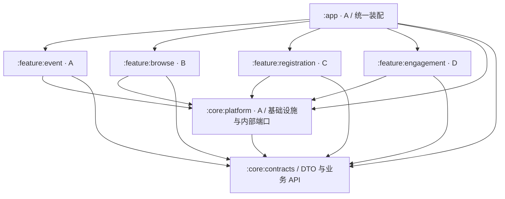
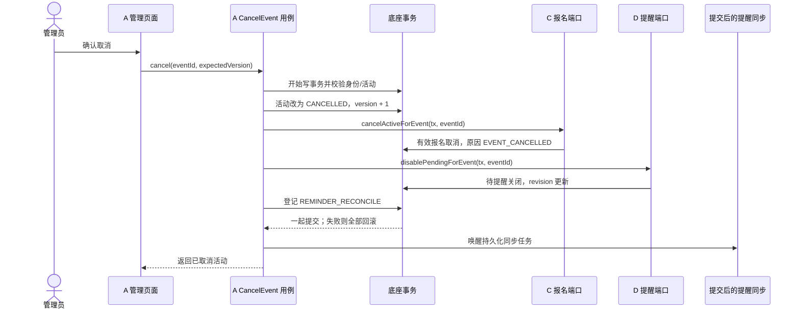

# 北航活动通：项目架构设计文档

版本：v0.1（工程实施基线）  
日期：2026-11-05  
适用团队：A、B、C、D 四人  
当前状态更新于 2026-11-06。七模块工程及 A 的公共底座和管理用例已落地。本文保留设计依据，实际协作入口为 [统一约定](协作开发统一约定.md)，实际签名见 [接口文档](interface-design.md)，字段见 [数据字典](data-dictionary.md)。B/C/D 的完整业务和最终集成仍按阶段推进。

## 1. 设计结论与范围

采用 **一个 APK、七个 Gradle 模块、接口隔离、应用壳统一装配、一个 SQLite 数据库、按功能拥有数据、统一事务执行** 的架构。

B、C、D 分别实现自己的功能模块，彼此不依赖实现代码。A 提供底座、活动基础数据和管理端，通过稳定接口装配各模块。活动详情拆成独立内容区与操作面板，跨模块写操作由明确的用例统筹。

这是针对本次“尽可能解耦、便于四人并行”的要求作出的设计调整：此前文档中的“一个 app 模块”是快速起步建议；本方案将其替换为多个 Gradle 模块，仍打包为一个 App。增加的构建与装配工作由 A 在底座阶段一次完成。

### 1.1 架构要达到的结果

1. B 修改时间轴和推荐，不需要修改 C、D 的 Java、XML 或 SQL 文件。
2. C 修改报名、签到，不需要理解 D 的提醒调度实现。
3. D 修改收藏、通知，不需要修改 B 的详情布局或 C 的报名代码。
4. 每个功能的界面、业务、数据访问与功能资源由同一负责人维护。
5. A 能通过接口调用协调活动取消、时间变更和身份切换，不复制其他成员的业务规则。
6. 未完成的模块能够以明确的“未接入”状态参与开发，正式版本必须全部接入真实实现。

业务上确实有关联的规则保留在显式接口中，例如取消活动必须影响报名和提醒。架构约束的是实现依赖、文件修改范围与调用方式，不承诺四人无需沟通即可随意修改公共契约。

### 1.2 技术与运行范围

| 项目 | 本方案决定 |
| --- | --- |
| 语言与界面 | Java、XML、AndroidX Fragment，页面采用 ViewModel 管理状态 |
| 应用交付 | 一个 Android App、一个 APK |
| 数据源 | 单进程、单个 SQLite 数据库 `campus_events.db` |
| 账号 | 预置管理员和两名学生，使用演示身份切换 |
| 同步含义 | 同一 App 内，保存后重新查询或刷新即可读到新状态 |
| 注入方式 | A 在应用壳中通过构造参数和工厂显式装配依赖 |
| 构建版本 | A 创建工程时锁定实际可运行版本，记录在 README；本设计不指定未经构建验证的版本号 |
| 选做 | B 的推荐、C 的签到反馈在各自模块扩展；摘要后续单独估时 |

接口与实现分离、由 app 模块装配功能的思路参考 Android 官方的[模块化模式与依赖倒置说明](https://developer.android.com/topic/modularization/patterns)。本文的七模块划分和业务接口是针对本项目作出的设计决定。

## 2. 模块划分与依赖方向

### 2.1 七个模块

| Gradle 路径 | 类型 | 负责人 | 内容与对外出口 |
| --- | --- | --- | --- |
| `:app` | Android Application | A | Application、主宿主、详情容器、身份入口、路由、依赖装配、最终打包 |
| `:core:contracts` | Java Library | A 协调，各业务负责人认领自己的包 | 公共 DTO、结果码、面向界面的业务 API；不引入 Android 类型 |
| `:core:platform` | Android Library | A | 数据库生命周期、会话、线程、事务、刷新通知、可靠副作用队列、内部端口、UI 注册接口 |
| `:feature:event` | Android Library | A | 活动基础读取、活动表、管理列表、新增编辑取消、活动变更用例 |
| `:feature:browse` | Android Library | B | 时间轴或日历、活动内容详情、列表聚合查询、兴趣推荐 |
| `:feature:registration` | Android Library | C | 报名、取消、人数规则、我的报名、报名面板、签到反馈 |
| `:feature:engagement` | Android Library | D | 收藏、我的收藏、提醒面板、系统调度、通知与恢复 |

`contracts` 只放跨边界的最小对象与接口。各模块自己的表单状态、Adapter、DAO、SQL、调度细节留在模块内部。

### 2.2 编译依赖图

图中箭头表示“左侧编译时依赖右侧”，不是业务事件流。



### 2.3 必须保持的依赖规则

- 四个 `feature` 模块之间不添加 Gradle 依赖，也不导入彼此实现包。
- 功能模块不依赖 `:app`，`core` 不依赖任何功能实现。
- 界面通过业务 API 操作数据；跨模块事务通过内部同步端口完成。
- 依赖从构造参数或模块工厂传入，功能代码不通过全局单例查找整个应用的所有服务。
- 底座提供数据库执行器与通用能力，不承担报名、收藏、提醒等业务规则。
- 依赖声明优先使用 `implementation`，每个模块直接声明自己实际使用的公共依赖。

Gradle 依赖隔离会阻止未声明依赖的直接引用；Java 类可见性、SQL 表访问范围仍需结合包封装和架构检查执行，不能把模块化当作数据安全边界。

## 3. 目录、文件和资源的所有权

### 3.1 项目目录

```text
北航活动通/
├── app/                         A：应用壳与装配
├── core/
│   ├── contracts/               公共契约，分包认领
│   │   └── .../contract/
│   │       ├── common/          A：结果、异步调用、公共时间约定
│   │       ├── session/         A：用户、角色、会话 API
│   │       ├── event/           A：活动对象和管理 API
│   │       ├── browse/          B：浏览与推荐 API
│   │       ├── registration/    C：报名和签到契约
│   │       └── engagement/      D：收藏和提醒契约
│   └── platform/               A：基础设施和内部协作端口
├── feature/
│   ├── event/                   A
│   ├── browse/                  B
│   ├── registration/            C
│   └── engagement/              D
├── docs/
│   ├── architecture-design.md   本文件
│   └── interface-design.md      创建工程后填写实际实现与接入示例
└── README.md                    实际构建、启动与演示说明
```

每个功能内部建议使用 `ui/`、`application/`、`data/`、`bootstrap/`：分别保存页面与状态、业务用例、DAO 与表结构、模块装配工厂。简单功能可合并内部文件，保持对外边界即可。

### 3.2 避免四人编辑同一文件

| 文件或资源 | 所有者及规则 |
| --- | --- |
| 根构建配置、版本配置、`settings.gradle` | A 初始化并协调修改 |
| `app` 主导航、详情容器、应用装配 | A；B、C、D 通过已经注册的入口接入 |
| 各功能 `build.gradle` | 对应成员；共同版本沿用根配置 |
| 各功能 Manifest | 对应成员；D 的 Receiver 与权限声明优先放在 D 的库 Manifest，由构建合并 |
| 功能布局、字符串、图片、图标 | 对应成员，使用模块资源前缀 |
| 公共主题、基础尺寸和颜色 | A 提供最小集合；功能新增资源放自己的模块 |
| 功能表结构与迁移 SQL | 功能所有者；数据库总版本由 A 协调 |
| 公共契约 | 按包认领；已被其他模块使用的签名变更先说明影响并同步修改 |

资源前缀固定为 `shell_`、`event_`、`browse_`、`reg_`、`eng_`，分别对应应用壳及四个功能。XML 中的 ID、字符串、布局和 drawable 同样遵守前缀。

## 4. 三类接口：用途与调用边界

| 接口类型 | 位置 | 调用者 | 用途与限制 |
| --- | --- | --- | --- |
| 业务 API | `contracts` | Fragment、ViewModel、模块内应用服务 | 异步查询与用户操作；隐藏数据库及系统实现 |
| 内部协作端口 | `platform/port` | 查询聚合器、跨模块写用例、DAO 适配器 | 在已有读范围或事务内同步执行；不供 Fragment 调用 |
| UI 注册接口 | `platform/ui` | 应用壳与功能 UI 工厂 | 注册页面、详情面板和 Fragment 重建工厂；允许使用 Android 类型 |

需要跨模块复用的是“查询报名状态”这类能力，而不是某个 `RegistrationRepositoryImpl` 或某个 Fragment。

## 5. 公共模型与结果约定

### 5.1 基本约定

- ID 为正整数，Java 使用 `long`；可空 ID 使用 `Long`。
- 时间保存 Unix 毫秒时间戳，Java 使用 `long`；显示与“今天”判断使用 `Asia/Shanghai`。
- 公共 DTO 使用不可变对象；集合返回只读副本，不返回 Cursor、数据库 Entity 或 View。
- 状态使用固定枚举或常量，入库沿用现有规则中的大写字符串。
- `EventInput` 只包含允许编辑的业务字段，不包含 ID、创建者、状态和审计时间。
- 当前操作者由底座会话获取，普通业务 API 不接收调用者自填的 `userId`。

### 5.2 必须明确的 DTO

| 对象 | 必须包含的内容 |
| --- | --- |
| `UserSnapshot` | `userId`、`displayName`、`role` |
| `SessionSnapshot` | 当前用户（未选择时为空）、持久化的 `epoch`；身份切换递增 epoch |
| `EventRecord` | 现有规则的全部活动字段，另增加 `version`；开始、截止、名额和来源保留原始值 |
| `EventInput` | 标题、介绍、地点、开始结束时间、报名截止、名额、分类、来源类型、来源说明、来源链接 |
| `EventFilter` | 可空的开始时间范围、分类、关键字及是否包含已取消活动；默认包含已取消活动，按开始时间升序、ID 升序 |
| `RegistrationSummary` | 有效人数、剩余名额、我的状态、取消原因、能否报名、拒绝原因、能否取消 |
| `EngagementSummary` | 是否收藏，以及当前用户的 `ReminderView` |
| `ReminderView` | 是否设置过、可空的提醒 ID/提前分钟/触发时间、业务状态、调度状态、调度错误码 |
| `EventView` | `EventRecord`、`evaluatedAt`、报名摘要和互动摘要的 `ModuleValue` |
| `RegistrationItem` | 我的报名记录与对应活动的最新基础资料 |
| `FavoriteItem` | 收藏时间与对应活动的最新基础资料 |

`RegistrationSummary.myStatus` 的 `NONE` 只表示未报名的查询结果，不向报名表写入这个状态。`ReminderView.configured=false` 时，提醒记录字段为空，不创建假记录。

`EventFilter` 的时间范围按活动 startAt 过滤，使用左闭右开区间；分类按固定值匹配，关键字匹配标题或地点。过滤参数全部可省略，界面不传 SQL 片段。

`ModuleValue<T>` 仅有 `READY(data)` 和 `NOT_READY` 两种状态。它用于开发阶段缺少某个功能实现时，明确表达“此项尚不可用”。真实数据库错误使整个查询失败，不伪装成未接入或人数为零。

### 5.3 结果与错误

```java
public interface AsyncCall<T> {
    CallHandle enqueue(ResultCallback<T> callback);
}

public interface ResultCallback<T> {
    void onResult(ApiResult<T> result);
}

public interface CallHandle {
    void cancelDelivery();
}
```

`ApiResult<T>` 固定包含 `success`、`code`、`message`、`data`。仅 `OK` 表示成功；失败数据为空；成功但无需数据也可为空。列表没有结果时成功返回空列表。

沿用原规则中的业务错误码，并增加以下架构所需的结果码：

| 新增结果码 | 语义 |
| --- | --- |
| `MODULE_NOT_READY` | 当前调用需要的实现尚未接入 |
| `SESSION_CHANGED` | 请求执行或返回期间身份已经变化，需要重新读取 |
| `STALE_DATA` | 编辑或取消使用的活动版本已过期，需要刷新后确认 |
| `INTERNAL_ERROR` | 未预期错误，记录诊断信息并给出可理解的失败提示 |

原有错误码包括 `NOT_LOGGED_IN`、`FORBIDDEN`、`EVENT_NOT_FOUND`、`INVALID_INPUT`、`EVENT_CANCELLED`、`EVENT_STARTED`、`REGISTRATION_CLOSED`、`EVENT_FULL`、`ALREADY_REGISTERED`、`CAPACITY_TOO_SMALL`、`REMINDER_TIME_PASSED`、`REMINDER_UNAVAILABLE`、`REMINDER_SCHEDULE_FAILED`、`DATABASE_ERROR`。界面按结果码处理，不比较中文字符串。

### 5.4 统一异步规则

1. 创建 `AsyncCall` 不执行操作；每个实例只能 enqueue 一次。
2. enqueue 时捕获身份 epoch；实际执行前由底座验证，角色在业务用例中再次检查。
3. SQLite 操作进入底座的单一数据库队列；业务 API 的最终回调统一回到主线程。
4. 内部同步端口直接使用当前执行范围，不再次 enqueue 或等待另一个业务 API。
5. `cancelDelivery()` 仅取消向该调用者交付结果。已经开始的写操作仍可能提交，重新进入页面需查询真实状态。
6. 身份已变化时，普通请求返回 `SESSION_CHANGED` 且不交付旧用户数据；身份切换请求本身成功返回新会话。
7. 页面销毁视图时取消交付，并通过请求序号丢弃比当前刷新更早的结果。数据库变更仍会发出刷新信号。

## 6. 面向界面的业务 API

以下签名是下一步底座的实施目标。具体包路径在工程创建后写入 `docs/interface-design.md`，业务语义保持本节约定。

### 6.1 A 提供：会话、活动基础读取与管理

```java
public interface SessionApi {
    AsyncCall<List<UserSnapshot>> listDemoUsers();
    AsyncCall<SessionSnapshot> current();
    AsyncCall<SessionSnapshot> switchDemoUser(long userId);
}

public interface EventReadApi {
    AsyncCall<List<EventRecord>> list(EventFilter filter);
    AsyncCall<EventRecord> get(long eventId);
}

public interface EventAdminApi {
    AsyncCall<EventRecord> create(EventInput input);
    AsyncCall<EventRecord> update(long eventId, long expectedVersion,
                                  EventInput input);
    AsyncCall<EventRecord> cancel(long eventId, long expectedVersion);
}
```

`EventReadApi` 独立于 B，供框架最小页面、管理端和其他功能使用。普通读取返回同一数据源中的活动；管理操作检查管理员身份。编辑与取消使用 version 防止旧表单覆盖新数据。

### 6.2 B 提供：浏览聚合查询

```java
public interface EventBrowseApi {
    AsyncCall<List<EventView>> list(EventFilter filter);
    AsyncCall<EventView> detail(long eventId);
}
```

B 在一个读范围内调用 A、C、D 的只读端口，组装展示对象。C 计算报名资格和人数，D 提供收藏及提醒状态，B 不复制这些规则。

开发阶段允许某一摘要为 `NOT_READY`，对应状态显示“待接入”且禁用相关操作；活动标题、时间、来源仍可展示。正式版本的所有必做摘要必须为 `READY`。

### 6.3 C 提供：报名

```java
public interface RegistrationApi {
    AsyncCall<RegistrationSummary> getSummary(long eventId);
    AsyncCall<RegistrationSummary> register(long eventId);
    AsyncCall<RegistrationSummary> cancelRegistration(long eventId);
    AsyncCall<List<RegistrationItem>> listMine();
}
```

报名时在同一写事务里读取最新活动、用户报名和余量，再插入或恢复报名。重复报名返回 `ALREADY_REGISTERED`；取消不存在或已取消的报名返回 `OK`，不创建记录。

### 6.4 D 提供：收藏与提醒

```java
public interface FavoriteApi {
    AsyncCall<Boolean> setFavorite(long eventId, boolean desiredState);
    AsyncCall<List<FavoriteItem>> listMine();
}

public interface ReminderApi {
    AsyncCall<ReminderView> get(long eventId);
    AsyncCall<ReminderView> set(long eventId, int leadMinutes);
    AsyncCall<ReminderView> disable(long eventId);
}
```

收藏传入目标状态，重复请求不反向切换。收藏、报名与提醒分别独立。

提醒 set 的成功回调要等本次调度尝试完成。权限或调度失败返回相应错误码；已保存的用户意图保留，后续查询明确显示 `BLOCKED` 或 `FAILED`，不能把写入数据库等同于已经设置系统提醒。等待期间界面显示正在设置。

## 7. 内部端口：实现隔离与事务协作

本节类型位于 `:core:platform`，允许使用底座提供的数据库执行范围。这里只定义接口，SQL 实现在相应功能模块中。

`ReadScope` 固定当前连接/读范围、受信任的操作者、会话 epoch 和本次 `now`；`TxScope` 是可写范围。它们只由底座创建，不能跨线程保存或在事务结束后使用。

```java
public interface EventReadPort {
    EventRecord require(ReadScope scope, long eventId);
    List<EventRecord> list(ReadScope scope, EventFilter filter);
}

public interface RegistrationReadPort {
    ModuleValue<Map<Long, RegistrationSummary>> summaries(
        ReadScope scope, List<EventRecord> events);
}

public interface RegistrationEventPort {
    int countActive(TxScope tx, long eventId);
    void cancelActiveForEvent(TxScope tx, long eventId);
}

public interface EngagementReadPort {
    ModuleValue<Map<Long, EngagementSummary>> summaries(
        ReadScope scope, List<EventRecord> events);
}

public interface ReminderEventPort {
    void onEventTimeChanged(TxScope tx, EventRecord before,
                            EventRecord after);
    void disablePendingForEvent(TxScope tx, long eventId);
}
```

### 7.1 端口的归属与使用者

| 端口 | 提供实现 | 注入到哪里 |
| --- | --- | --- |
| `EventReadPort` | A | B 的聚合查询、C 的报名、D 的收藏提醒 |
| `RegistrationReadPort` | C | B 的聚合查询 |
| `RegistrationEventPort` | C | A 的名额修改及取消活动用例 |
| `EngagementReadPort` | D | B 的聚合查询 |
| `ReminderEventPort` | D | A 的时间修改及取消活动用例 |

这些方法同步返回，只访问已有范围内的数据。失败抛出底座统一的业务失败或数据库异常，由最外层回滚并转换成 `ApiResult`。端口实现不能吞掉失败继续返回成功。

### 7.2 防止端口变成另一个耦合入口

- 端口实现只操作本功能拥有的表，读取其他功能数据通过只读端口。
- A 的取消流程调用 C、D 的端口，不直接编写更新报名、提醒表的 SQL。
- 端口不得开始或提交独立事务，也不得关闭数据库。
- 端口不调用 Android 通知、AlarmManager、UI 或网络。
- 批量摘要必须返回所有传入活动的摘要；真实无记录时返回零人数/未收藏等真实结果。
- B 的聚合查询在同一读范围内批量读取，避免每个列表项分别请求人数和收藏状态。
- `canRegister`、`canCancel` 由 C 的同一规则实现用于查询与写校验，写入时仍重新判断最新状态。

## 8. 页面组合：B、C、D 各自维护自己的面板

### 8.1 页面归属

| 页面或区域 | 所有者 | 接入方式 |
| --- | --- | --- |
| 身份选择、主导航 | A | 应用壳内实现 |
| 学生活动列表、兴趣设置 | B | 注册屏幕工厂 |
| 活动详情宿主和三个容器 | A | 只负责组合和传入 eventId |
| 详情的标题、时间、地点、介绍、来源 | B | `CONTENT` 面板 |
| 详情的报名人数、我的报名、报名/取消按钮、签到反馈 | C | `REGISTRATION` 面板 |
| 详情的收藏、提醒设置、权限提示 | D | `ENGAGEMENT` 面板 |
| 我的报名 | C | 注册屏幕工厂 |
| 我的收藏 | D | 注册屏幕工厂 |
| 活动管理列表、新增和编辑 | A | event 模块注册屏幕工厂 |

```text
活动详情宿主（A）
├── shell_detail_content_slot       B：活动内容
├── shell_detail_registration_slot  C：报名 / 签到反馈
└── shell_detail_engagement_slot    D：收藏 / 提醒
```

B 不在自己的 XML 中嵌入 C、D 的具体 Fragment。C、D 不查找 B 的 View ID、不修改 B 的 ViewModel，也不通过强制转换取得宿主中的其他模块实例。

详情容器安排滚动和面板顺序，各面板适应父容器宽度，避免各自创建嵌套的整页滚动。内容较长的反馈编辑等操作可打开模块自己的页面或对话框。

### 8.2 UI 接口

```java
public interface FeatureUiEntry {
    Set<ScreenKey> screens();
    Fragment createScreen(ScreenKey key, RouteArgs args);
    Set<String> fragmentClassNames();
    Fragment instantiate(String fragmentClassName);
}

public interface DetailPanelProvider {
    DetailSlot slot();
    Fragment createPanel(long eventId);
}

public interface Navigator {
    void open(Route route);
    void back();
}
```

这些接口在 `platform/ui` 中，允许使用 AndroidX Fragment。每个功能注册自己的屏幕、一个详情面板（如适用）及 Fragment 重建方法。屏幕与面板的重复注册在启动时直接报错，不采用覆盖顺序决定归属。

应用壳维护 `ScreenKey -> FeatureUiEntry` 和 `DetailSlot -> DetailPanelProvider` 的显式映射。功能内跳转只调用 `Navigator`，不构造其他功能的 Activity 或 Fragment。

路由至少包含 `EVENT_LIST`、`EVENT_DETAIL(eventId)`、`MY_REGISTRATIONS`、`MY_FAVORITES`、`ADMIN_LIST`、`ADMIN_CREATE`、`ADMIN_EDIT(eventId)`。参数只传 ID 和简单导航数据，页面自己重新查询。

### 8.3 旋转屏幕与进程重建

A 的宿主安装组合 `FragmentFactory`，按类名将重建请求交给相应 `FeatureUiEntry`。在系统恢复 Fragment 之前配置工厂；Activity 中应在 `super.onCreate()` 前完成相关设置。

构造函数依赖由工厂注入，活动 ID 保存在 Fragment arguments 中。ViewModel 使用对应的工厂创建，临时表单状态通过保存状态机制恢复。重建时不重复添加已经由系统恢复的面板。

仅在首次创建时手动 `new Fragment(dependencies)` 不能覆盖系统重建路径；工厂方案依据 Android 官方的[Fragment 依赖提供与重建说明](https://developer.android.com/guide/fragments/fragmentmanager)。

### 8.4 通知跳转

A 提供 `NotificationRouteFactory` 接口的实现，D 通过它取得指向应用壳的 PendingIntent。D 不需要依赖 `:app` 或知道宿主 Activity 的类名。

通知路由包含 eventId 和接收者 userId。点击后 A 验证当前身份；身份不符则进入身份选择，不自动切换账号。进入详情后按当前身份重新读取数据，活动已取消也应展示实际状态。

## 9. 数据所有权、建表与迁移

### 9.1 每张表有唯一所有者

| 表 | 所有者 | 其他模块访问方式 |
| --- | --- | --- |
| `users` | A / platform 会话 | SessionApi 或受信任执行范围 |
| `events` | A / event | EventReadApi、EventReadPort |
| `registrations` | C | RegistrationApi、报名只读和事务端口 |
| `favorites` | D | FavoriteApi、EngagementReadPort |
| `reminders` | D | ReminderApi、提醒事务端口 |
| `app_session` | A / platform | 会话入口与底座请求上下文 |
| `system_effects` | A / platform | 通用副作用队列入口 |
| `user_interests`（选做） | B | B 的推荐接口 |
| `checkins`（选做） | C | C 的签到反馈接口 |

表的所有者编写 SQL、索引、约束和迁移，并实现读取或变更端口。其他模块不直接 JOIN 或更新这张表。查询聚合通过各表所有者的批量端口完成。

数据库只有一个 Helper，由 A 的底座持有。各模块的 DAO 使用当前执行范围提供的数据库句柄，不自行打开另一份库。句柄只进入 data 层和端口适配层，不注入 UI。

### 9.2 本设计对原数据清单的明确扩展

原清单中的业务字段、唯一约束、外键和状态继续采用。本架构为并行编辑、提醒恢复增加以下内容，创建工程时需同步进实际数据字典：

| 扩展 | 字段与用途 |
| --- | --- |
| `events.version` | 正整数，创建为 1，每次成功编辑或取消加 1；用于旧表单冲突检查 |
| `reminders.revision` | 正整数，提醒意图或触发规则变化时递增；旧系统回调携带旧 revision 时失效 |
| `reminders.deliveryState` | `PENDING`、`SCHEDULED`、`BLOCKED`、`FAILED`、`NOT_REQUIRED`，表达最后一次调度处理状态 |
| `reminders.deliveryError` | 空字符串或稳定结果码，便于页面展示与重试 |
| `app_session` | 固定单行：singletonId、可空 currentUserId、epoch，身份变更与队列登记可同事务提交 |
| `system_effects` | effectKey 主键、requestedVersion、appliedVersion、attempts、lastError、updatedAt |

`reminders.status` 仍表示 `PENDING / DISABLED / SENT / EXPIRED` 的业务进度；`deliveryState` 表示调度结果，两者不能混用。`SCHEDULED` 表示系统调度接口已接受本次设置，不承诺系统一定准点送达。

`revision` 在设置、关闭、时间重算、发送或过期等改变提醒业务状态时更新；仅记录调度成功或失败不递增。系统回调同时携带 reminderId、revision、triggerAt 和会话 epoch，并再次读库验证。

### 9.3 初始化与迁移

1. 每个模块提供自己的 `SchemaContributor`：模块 ID、建表步骤、索引和该模块需要的迁移步骤。
2. A 在打开数据库前统一注册贡献者，按 users → events → registrations/favorites/reminders 的依赖顺序创建。
3. A 维护唯一数据库总版本和迁移执行计划。各模块不在运行时自行增加总版本号。
4. 外键在数据库连接配置时实际开启，初始 DDL 包含非空、合法状态、时间和正整数约束。
5. 报名、收藏、提醒均保留 `(userId, eventId)` 唯一约束；scheduleId 另外唯一。
6. 演示用户和演示活动只在首次初始化或明确重置时生成，来源明确标注。
7. 正常升级保留业务数据；模块迁移先更新结构，再运行新查询。

SQLite 外键需在连接上启用，不能只声明外键就假定已生效，见[SQLite 外键说明](https://www.sqlite.org/foreignkeys.html)。

## 10. 线程、事务与一致性

### 10.1 统一执行模型

底座提供一个进程级 `dataExecutor` 串行队列。所有 SQLite 操作、会话切换，以及提醒最终校验与短时本地系统调用都经过该队列；主线程负责 UI 和结果回调。

查询聚合在同一个固定读范围内完成，所有参与端口共享范围及 `now`，不在聚合中穿插其他写任务。写用例由最外层执行器建立事务，内部端口加入现有事务。

提醒系统调用在数据库事务提交后、同一串行队列中执行。这样单进程内的最终状态检查、通知提交与活动取消不会被不同执行线程交错。网络、OCR、模型请求等长任务使用独立执行器，结果保存时重新验证会话和数据版本。

内部端口不能向同一队列提交任务后同步等待；这会造成自我等待。用例也不能在等待权限弹窗期间占住队列。

SQLite 同时只能有一个写事务。本设计将课程规模的本地访问串行化，简化并发规则；事务与写并发的机制见[SQLite 事务说明](https://www.sqlite.org/lang_transaction.html)。

### 10.2 各类操作的原子边界

| 操作 | 同一数据库事务中的内容 | 提交后执行 |
| --- | --- | --- |
| 报名/取消报名 | 校验最新活动、本人记录、余量，写入报名 | 发布刷新信号 |
| 修改名额 | 校验活动版本，查询有效人数，检查新名额，更新活动 | 发布刷新信号 |
| 修改活动时间 | 更新活动，D 重算待提醒并更新 revision/调度状态，登记同步任务 | D 重设系统提醒，发布调度结果 |
| 取消活动 | 取消活动，C 取消有效报名，D 关闭待提醒，登记同步任务 | D 取消系统提醒，发布刷新信号 |
| 设置/关闭提醒 | 更新用户意图、revision、调度状态，登记同步任务 | D 调度或取消，回写调度结果 |
| 切换身份 | 更新 app_session 与 epoch，登记同步任务 | 取消旧身份调度、恢复新身份调度、切换页面 |

只有事务成功提交后才发送刷新信号。发生任何业务失败或 SQL 失败，整笔写操作回滚，不触发成功回调或该事务对应的系统副作用。

底座对模块 application/data 层提供如下执行入口：

```java
public interface DataAccess {
    <T> AsyncCall<T> query(ReadWork<T> work);
    <T> AsyncCall<T> command(WriteWork<T> work);
}

public interface ReadWork<T> {
    T run(ReadScope scope);
}

public interface WriteWork<T> {
    T run(TxScope tx);
}
```

ReadScope 至少提供 `actor()`、`sessionEpoch()`、`now()` 和供 DAO 使用的 `database()`；TxScope 另提供 `invalidate(ChangeSet)` 与 `requestEffect(EffectKey)`。受信任 Actor 的用户 ID 和角色由底座会话构造，未选择身份时使用明确的匿名状态。

`database()` 是内部 SQLite 接入点，只允许 DAO 和存储适配器使用，不作为界面契约导出。读任务不能执行写 SQL，写任务不能提前提交或将 scope 保存给后续回调。底座将任务异常转换为第 5 节的失败结果。

例如 C 的 register API 返回 `dataAccess.command(...)` 创建的调用，在任务内检查学生角色、经 EventReadPort 取得活动，再由 C 的规则与 DAO 完成报名。A 和 D 使用相同入口创建各自写用例，因此事务与回调语义一致。

底座在写事务提交后先进行本次已登记任务的首次同步尝试，再交付 command 的结果。普通管理命令的成功仍以业务事务提交为准；系统尝试失败通过调度状态另行展示。ReminderApi.set 在内部等待该阶段后读取本次 reminder revision 的最终调度状态，再决定对外返回 OK 或提醒错误码。它不能把通用 command 的成功直接转发成“提醒设置成功”。

### 10.3 身份与异步操作

- 普通操作从受信任会话生成 Actor，不接受页面任意构造的身份。
- 身份切换增加持久化 epoch；请求入队时记录 epoch，执行时验证。
- 系统提醒接收器读取数据库中的当前会话，不使用某个旧页面保存的用户对象。
- 查询返回前若发现身份已变化，返回 `SESSION_CHANGED`，页面按新身份重新加载。
- 若写操作已提交后才发生身份切换，写入属于操作执行时的原用户；新用户页面不得应用旧回调，也不得自动重试该写入。

身份切换不直接调用 D 的数据库写入接口。A 在同一事务登记提醒同步任务，D 的处理器读取最新会话决定应启用哪些提醒。D 尚未接入时任务保留，身份选择和 B、C 的开发仍可正常进行。队列存在未处理的相关同步任务时，D 的查询不能直接把旧的调度成功状态展示为当前已生效。

## 11. 核心跨模块流程

### 11.1 取消活动：必须由显式事务用例编排



校验顺序：管理员权限 → 活动存在 → 若已经取消则返回当前记录作为幂等成功 → 否则检查 expectedVersion 和尚未开始 → 执行取消。

该流程不通过广播事件让 C、D 各自晚些时候改库。那样会出现活动已取消但报名仍有效的中间状态，也无法一起回滚。

### 11.2 修改活动时间

1. A 在写事务中验证活动版本和 `deadline <= start < end`，更新活动及 version。
2. D 仅重算 `PENDING` 提醒的触发时间，更新 revision。
3. 新触发时间已过去的提醒改为 `EXPIRED`，其余保持待提醒并标记待调度。
4. 同事务登记提醒同步任务；提交后取消旧调度、创建新调度。
5. 收藏和报名记录保留。B 重新读取新时间，D 面板展示调度结果。

调度失败不回滚已经保存的活动时间；页面明确提示提醒尚未生效或需要重新设置。

### 11.3 报名与名额修改

C 报名时和 A 修改名额时，都使用同一个底座写事务入口。C 提供有效人数统计，A 不另存一个报名计数。最后一个名额、取消后重报、名额下调等操作依此串行校验。

活动时间或名额在打开页面后发生变化时，C 仍使用执行时重新读取的活动检查。界面的“可以报名”只用于交互提示，不替代写入校验。

## 12. 提醒可靠性：数据库意图与系统操作分开记录

### 12.1 为什么设置持久化副作用队列

活动修改已经提交，但 App 在重设系统闹钟前退出时，内存通知会丢失。为使恢复后仍能知道需要同步，底座将“需要同步提醒”的记录与业务变更一起写入数据库。

本项目先只使用一个合并任务键 `REMINDER_RECONCILE`，由 D 提供处理器。处理器以数据库最新状态为准，检查所有已有提醒的系统调度，不依赖过期的事件快照。

处理器的内部接入契约如下，同样位于 platform；具体实现留在 D：

```java
public interface EffectHandler {
    EffectKey key();
    EffectOutcome reconcile(EffectContext context);
}

public interface EffectContext {
    long requestedVersion();
    <T> T read(ReadWork<T> work);
    <T> T write(WriteWork<T> work);
}
```

EffectOutcome 使用 `APPLIED`、`RETRY_LATER`、`MODULE_NOT_READY`。处理器在 dataExecutor 中同步执行，context.read/write 直接建立本次读范围或新事务，不重新排队；系统调用安排在这些事务之外。write 用于记录调度结果及失效通知，不再次递归执行任务。数据库已提交之后，处理器失败只保留同步任务和错误状态，不改变原业务事务的成功事实。

### 12.2 队列规则

- 固定任务行使用 requestedVersion 和 appliedVersion；每次需要同步时前者递增。
- 处理器记录本次处理版本，成功后仅确认该版本，后续新请求仍可继续处理。
- 任务行保留，避免删除再插入导致旧处理结果错误覆盖新请求。
- 调度操作使用稳定 scheduleId；多次同步得到相同目标状态。
- 失败记录 attempts、lastError，并更新对应提醒的 deliveryState；采用有限重试，权限缺失不进行忙循环。
- 启动恢复、设备重启、收到旧提醒回调、权限状态变化及用户重试时，可再次唤醒同步。
- 模块未接入时任务保留，不能由空处理器假装完成。

### 12.3 D 的同步处理器必须执行的检查

1. 当前身份是否为该提醒所属学生。
2. 活动是否正常且尚未开始。
3. 提醒是否 PENDING，触发时间是否仍在未来。
4. 通知权限和所选定时方式需要的系统访问条件是否满足。
5. 不应启用的调度取消；仍有效的调度按最新 revision 和时间设置。
6. 系统操作后更新 deliveryState 和错误信息，成功处理的版本得到确认；失败保留待处理状态并等待受控重试。

提醒触发时同样进入 dataExecutor，重新验证会话 epoch、revision、triggerAt、提醒状态和活动状态，随后在事务外提交通知。正常发送后记为 SENT；重复回调不重复创建新的通知记录。

通知与数据库不支持跨系统原子事务。实现使用稳定通知标识和状态复查处理普通重复回调；极端的“系统通知已提交、SENT 尚未落库时进程终止”仍存在恢复窗口，不宣称端到端恰好一次送达。

持久化任务保证恢复后能够补做，不保证进程退出后立即运行。指定时间通知需要 D 在实际演示设备上验证，不能用应用内倒计时替代。

Android 通知权限与精确定时访问需要分别检查，具体实现参见[通知运行时权限](https://developer.android.com/develop/ui/compose/notifications/notification-permission)及[闹钟调度](https://developer.android.com/develop/background-work/services/alarms)官方文档。底座只规定失败与恢复契约，具体系统适配由 D 封装。

## 13. 页面刷新：通知失效，重新查库

底座提供轻量 `DataInvalidation` 接口，用来通知“哪些数据可能变了”。业务事实仍保存在数据库中。

| 信号主题 | 触发场景 | 需要重查的页面 |
| --- | --- | --- |
| `EVENT_CONTENT` | 新增、编辑、取消活动 | B 列表与内容面板，C/D 对应面板，A 管理列表 |
| `REGISTRATION` | 报名、取消、活动取消导致的报名变化 | B 报名状态展示，C 面板和我的报名，A 容量显示 |
| `ENGAGEMENT` | 收藏、提醒意图变化 | B 相应展示，D 面板和我的收藏 |
| `REMINDER_DELIVERY` | 调度尝试完成或权限状态变化 | D 提醒状态展示 |
| `SESSION` | 身份切换 | 宿主及所有当前用户相关界面 |

信号可携带 eventId 集合和相关用户 ID，供页面减少无关刷新；报名人数属于活动全局信息，不能只按报名用户过滤掉其他观察者。

订阅按视图生命周期释放。进入、返回、主动刷新和本人操作完成后也重新读取，因此遗漏一次内存信号不会使界面永久停留在旧状态。同一轮多条失效通知可合并为一次刷新。

功能间不使用事件总线发送“人数减一”“切换收藏”等命令，不依赖信号监听器完成关键业务写入。

## 14. 应用装配：A 一次接好入口，BCD 替换各自实现

### 14.1 创建顺序与循环依赖处理

A 在 `app/bootstrap/AppGraph` 中完成装配。构造组件时不立即读库，也不发出业务请求，全部注册完成后再启动。

| 顺序 | 装配动作 |
| --- | --- |
| 1 | 收集 core 与各功能的 SchemaContributor，创建数据库及执行器配置 |
| 2 | 创建 platform，提供会话读取、事务、时钟、失效通知、路由抽象和副作用队列 |
| 3 | 创建 EventModule 的基础部分，取得 EventReadPort、EventReadApi |
| 4 | 创建 C 的组件，注入 EventReadPort，取得报名 API、只读端口、活动变更端口与 UI 工厂 |
| 5 | 创建 D 的组件，注入 EventReadPort 和通知路由工厂，取得收藏提醒 API、只读端口、活动变更端口、同步处理器与 UI 工厂 |
| 6 | 将 C、D 的活动变更端口传给 A 的管理用例，得到 EventAdminApi |
| 7 | 创建 B 的组件，注入 A、C、D 的只读端口，得到浏览 API 和 UI 工厂 |
| 8 | 注册路由、详情面板、Fragment 重建工厂、提醒同步处理器及身份切换需要登记的任务键 |
| 9 | 校验注册完整性，打开并初始化数据库，恢复会话，唤醒待处理任务，展示首屏 |

关键是 EventModule 分成“基础读取”和“管理用例装配”两个创建步骤。C、D 只需要前者，管理用例再接入 C、D 的端口，因此无需互相 setter 注入或互相创建对象。

同样，D 不依赖 C 的报名能力，因为本方案允许未报名用户设置提醒。B 的查询聚合器依赖三个只读端口，而它们不反向依赖 B。

### 14.2 各成员固定交付的模块出口

| 模块 | 必须导出的装配入口与产物 |
| --- | --- |
| A / event | EventModule 工厂、EventReadApi、EventReadPort、可单独创建的 EventAdminApi、管理 UI、SchemaContributor |
| B / browse | BrowseModule 工厂、EventBrowseApi、浏览 UI、CONTENT 面板；选做时增加兴趣表贡献者 |
| C / registration | RegistrationModule 工厂、RegistrationApi、RegistrationReadPort、RegistrationEventPort、报名 UI 与面板、SchemaContributor |
| D / engagement | EngagementModule 工厂、FavoriteApi、ReminderApi、EngagementReadPort、ReminderEventPort、提醒同步处理器、UI 与面板、SchemaContributor |

工厂接收明确命名的依赖对象，按业务与 UI 分组；不要把整个 AppGraph 作为参数交给每个功能。AppGraph 只在应用壳中持有，不暴露给模块业务代码。

### 14.3 尚未完成的模块如何接入

底座提供开发专用的未接入适配器，并在初始装配中预留固定位置：

- C、D 的只读适配器返回 `ModuleValue.NOT_READY`，B 可继续展示活动基本内容。
- C、D 的业务 API 返回 `MODULE_NOT_READY`；对应面板显示待接入并禁用操作。
- 需要 C、D 参与的活动变更端口直接失败，整笔操作回滚；不能静默跳过报名或提醒处理。
- 身份切换只保存会话并登记任务，可以正常使用；缺少的提醒处理器不确认待处理任务。
- A 的 EventReadApi 和新增活动是真实实现，作为最小框架的运行路径。
- 测试用 Fake 只放 test 源集，不作为生产数据或正式成功结果。
- 正式构建入口检查全部必做 API、事务端口和 UI 均为真实实现；检查不通过则阻止正式打包。

BCD 各自在已创建的模块出口中替换适配器或工厂实现，保持同一契约。正常功能迭代只修改自己的模块；初次真实实现接入由 A 核对一次装配。

## 15. 四人可直接领取的开发任务

### 15.1 A：底座和活动管理

1. 建立七模块工程，固定公共版本与资源前缀，跑通构建。
2. 实现 contracts 和 platform 的最小公共契约、会话、单队列、事务、结果回调。
3. 提供统一数据库、SchemaContributor 机制、五张业务表的初始结构骨架，以及两个基础设施表。
4. 完成真实用户与活动初始化、活动基础读写、最小学生页面。
5. 完成详情三个容器、路由映射、UI 注册及 Fragment 恢复工厂。
6. 提供 C、D 的明确未接入适配器和 B 的最小浏览实现，保证工程可编译。
7. 完成接口文档、构建说明、接入示例和底座自检，再交接给 BCD。
8. 继续完成管理端表单和用例，将跨模块能力保留为注入端口。
9. 牵头真实实现接入、集成用例和最终打包。

初始表结构由 A 按已有规则生成并与本设计对齐，交接后报名表归 C、收藏提醒表归 D；各自继续维护 DAO 和业务实现。底座无需提前实现完整报名、收藏或通知。

### 15.2 B：浏览与推荐

输入依赖：EventReadPort、RegistrationReadPort、EngagementReadPort、查询执行器、时钟、失效通知、Navigator。

交付顺序：先 EventBrowseApi 的聚合查询与时间轴，再 CONTENT 面板，最后兴趣推荐。列表报名状态使用 C 的摘要，收藏状态使用 D 的摘要；两者未接入时明确显示不可用。

主要改动范围：`feature/browse`、`contracts/browse`，以及选做兴趣表。B 不负责编辑报名面板和提醒面板。

### 15.3 C：报名与签到反馈

输入依赖：EventReadPort、数据库执行器、受信任会话、时钟、失效通知、Navigator。

交付顺序：优先提供只读摘要与活动取消端口，再实现报名/取消写用例、REGISTRATION 面板和我的报名，最后扩展签到反馈。只读摘要、报名写入与 A 的名额检查使用统一有效人数口径。

主要改动范围：`feature/registration`、`contracts/registration`，报名和签到相关表及迁移。

### 15.4 D：收藏与提醒

输入依赖：EventReadPort、数据库执行器、受信任会话、时钟、失效通知、Navigator、通知路由工厂、副作用队列入口。

交付顺序：早期先做系统通知与定时调度的真机可行性验证；再完成收藏和只读摘要、活动变更端口；随后完成提醒设置、同步处理器、Receiver、ENGAGEMENT 面板和恢复流程。

主要改动范围：`feature/engagement`、`contracts/engagement`，收藏提醒表、相关权限和 Receiver。系统差异封装在模块内部，不向 B、C 暴露。

## 16. 底座交接和架构验收

### 16.1 A 交接之前必须可验证的内容

- [ ] 七个模块存在，功能模块之间没有实现依赖或编译环。
- [ ] 其他三人按 README 能构建、启动和进入演示身份。
- [ ] 用户和活动真实落库，重启保留，初始化不重复。
- [ ] 能通过 EventReadApi 展示一条活动及来源。
- [ ] 当前用户、epoch、毫秒时间戳、版本号与结果码约定已落在代码中。
- [ ] 异步回调在主线程，数据操作离开主线程，内部事务端口同步执行。
- [ ] 三个详情容器和各模块工厂存在，旋转后可以恢复。
- [ ] 未接入功能清楚标识，缺少关键事务端口会失败并回滚。
- [ ] 队列能够与一笔示例事务一起登记，失败回滚不留“成功任务”。
- [ ] README 和实际接口文档写清路径、签名、状态、线程、接入样例及未实现项。

### 16.2 针对风险的验证

| 验证项 | 负责人 | 关键断言 |
| --- | --- | --- |
| 依赖边界检查 | A | feature 之间无 Gradle/实现包依赖，UI 不导入数据库执行范围 |
| 只读聚合 | B + C + D | 同一个活动的基本数据、人数、收藏来自同一读范围；缺实现不冒充零值 |
| 报名边界 | C | 重复点击不增人、最后名额仅一人成功、取消和重报保持唯一记录 |
| 修改名额 | A + C | 不得小于有效人数，旧版本表单不能覆盖新活动 |
| 取消回滚 | A + C + D | 在 C 或 D 端口注入失败，活动、报名、提醒全部保持原状态，队列不登记 |
| 时间修改 | A + D | 旧 revision 失效，新调度时间正确，已错过提醒不补发 |
| 身份切换 | 全员 | 延迟的旧用户回调不影响新页面，个人记录不串号，旧提醒失效 |
| 生命周期 | 全员，A 验证宿主 | 旋转、返回和进程重建不缺依赖、不重复面板 |
| 提醒恢复 | D，A 验证队列 | 提交后中断，再启动能够看到未完成任务并重做，失败不显示设置成功 |
| 最终构建 | A | 必做真实实现已接入，开发适配器不可进入提交版本 |

业务纯规则可使用单元测试；SQLite 唯一约束、事务回滚、迁移和最后名额需使用真实数据库验证；通知、权限、重启和后台触发在演示设备验证。无需为每个布局控件编写镜像测试。

### 16.3 各模块可独立执行的构建入口

工程创建后至少保证以下任务有效，命令在项目根目录的 PowerShell 中运行：

```powershell
.\gradlew.bat :core:contracts:test
.\gradlew.bat :feature:browse:assembleDebug
.\gradlew.bat :feature:registration:assembleDebug
.\gradlew.bat :feature:engagement:assembleDebug
.\gradlew.bat :app:assembleDebug
```

功能库的 assemble 验证编译与资源；实际运行由同一个开发 App 承载。各模块测试通过 Fake 端口替换不属于自己的依赖，不等待其他模块 UI 完成。

## 17. 分阶段实施与接口变更规则

| 阶段 | 应达到的状态 |
| --- | --- |
| P0：底座 | A 建七模块、契约、数据库、会话、最小页面、UI 工厂和开发适配器；BCD 可并行做数据、业务边界和系统验证 |
| P1：并行开发 | B 浏览、C 报名、D 收藏提醒、A 管理端，各自使用稳定端口和模块测试 |
| P2：首轮接入 | BCD 换为真实实现，优先跑通管理员新增 → 学生可见 → 报名人数变化 |
| P3：联动 | 取消、时间修改、身份切换、提醒恢复与异常状态跑通 |
| P4：选做与交付 | 完成推荐和签到反馈，固定版本、验证安装和重启、整理材料 |

接口变更分三类处理：

1. **模块内部变化：**成员自己完成，只要公共语义与输出不变，无需其他成员改代码。
2. **兼容扩展：**新增可选字段或独立接口，说明默认值、接入方式和是否迁移，原调用继续有效。
3. **破坏性变化：**删除/改名方法、改变时间单位或状态语义等，列明受影响模块，在同一集成改动中更新契约、调用、迁移、测试和文档。

公共规则出现调整时更新本文件与数据字典；`docs/interface-design.md` 记录实际代码位置、已实现签名、调用示例和状态。文档与代码一致后，接口基线升级为 v1.0。

## 18. 本方案的取舍与后续扩展

| 决策 | 带来的收益 | 需要承担的成本 |
| --- | --- | --- |
| 七个 Gradle 模块 | 编译依赖可检查，四人目录和资源边界清楚 | A 需要先处理公共构建和装配 |
| 集中 contracts，分包认领 | 每人清楚可调用什么，Java DTO 易于测试 | 公共签名变化仍需同步沟通 |
| 单库、表归属、事务端口 | 保留跨表原子性，SQL 留在业务所有者模块 | 存储技术共同采用 SQLite；表访问范围需架构检查 |
| 详情面板独立 | BCD 各自维护界面、状态和生命周期 | A 负责容器、工厂与重建路径 |
| 单进程串行数据队列 | 小规模课程数据下便于避免写竞争和通知检查竞态 | 队列内不能执行网络等长任务 |
| 持久化提醒同步任务 | 进程恢复后可补做系统操作，失败状态可追踪 | 增加一张基础设施表和 D 的同步处理器 |

后续若需要网络数据源，优先替换数据适配层，保留面向 UI 的 API；跨设备报名将需要服务端事务，不能直接沿用本地锁作为全局容量保证。

摘要功能实施时可新增自己的功能模块和契约，复用会话、活动读取及导航；模型调用放独立执行器，结果保存重新验证当前用户。基础版本无需提前加入模型依赖。

## 19. 依据与设计状态

本地项目依据：

- `2026安卓课程项目题目与评分标准_新版(1).docx` 的第四题和通用质量条目。
- `项目设计说明_易读版.md` 的四人分工与功能描述。
- 本文件的模块化设计与 `协作开发统一约定.md`、`interface-design.md`、`data-dictionary.md` 的实施基线。

早期设计曾引用另外三份分工/数据清单，当前目录中缺少原文件。已根据现有作业要求、两份设计文档和实际代码补全实施口径。

官方机制参考已在相关章节链接：Android 模块化、Fragment 重建、通知与闹钟，以及 SQLite 事务与外键。

本文件中的“拟定”“创建后”等表述保留设计时点含义，实际状态以开头链接的实施文档和 A 交付验收记录为准。


