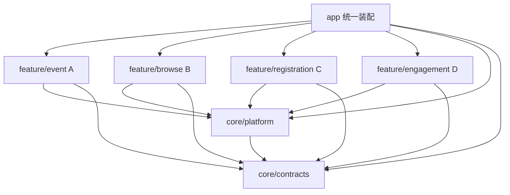

# 北航活动通协作开发统一约定

版本 v1.0，日期 2026-11-06，适用 A、B、C、D。本文是工程协作入口，签名及调用示例见 [接口文档](interface-design.md)，落库字段见 [数据字典](data-dictionary.md)，构建与验收见 [README](../README.md)。

第四题使用 Java、XML、AndroidX Fragment 和本地 SQLite，最终交付一个 APK。管理员与两名学生在同一设备切换演示身份，所有页面读取同一数据库。用户端同步的含义是提交后重查即可读取最新状态。

## 1 交付边界和评分归属

| 成员 | 独占目录 | 必须交付 | 原始评分点 |
| --- | --- | --- | --- |
| A | app、core/platform、feature/event、根构建配置 | 工程、会话、数据库与事务、装配、导航、详情宿主、管理员新增编辑取消、整合 | 发布维护 10 分，协助通用质量 20 分 |
| B | feature/browse | 日历或时间轴、详情内容、报名状态展示、来源说明 | 活动展示 15 分，选做推荐 8 分 |
| C | feature/registration | 报名取消、人数名额、防重、我的报名、报名面板、活动取消端口 | 报名管理 20 分，选做签到反馈 6 分 |
| D | feature/engagement | 收藏取消、我的收藏、提醒、真实系统通知、调度及恢复、活动变更端口 | 收藏提醒 15 分 |

活动摘要为选做 6 分，需要单独排期与确认接口。各人先完成必做闭环。原始评分依据是 docs 中《2026安卓课程项目题目与评分标准_新版(1).docx》的“四 北航活动通”和通用质量条目。

`core/contracts` 按 common/session/event 归 A，browse 归 B，registration 归 C，engagement 归 D。公共包已经被其他人依赖后，签名和语义调整须通过第 10 节的变更流程。

当前 A 基础设施与管理用例已落代码。B 拥有可运行的基础活动入口和聚合查询起点，C、D 拥有 Schema 与明确未接入的适配器。各成员接管自己的出口实现即可继续。正式集成仍需 B、C、D 的实际功能和设备验收。

## 2 模块依赖规则

- feature 之间不声明 Gradle 依赖、不导入彼此实现包、不引用彼此 R 类或 XML ID。
- feature 不依赖 app，core 不依赖 feature。纯 Java contracts 不引入任何 Android 类型。
- app/bootstrap/AppGraph 是唯一装配根。功能工厂接收 DataAccess、所需端口、Navigator 等明确能力，功能内部不查找 AppGraph 或 Application 全局服务。
- UI 使用异步业务 API。聚合查询和联动写用例使用同步端口。DAO 与 SQL 归各表所有者。
- 各功能可单独执行 assembleDebug，使用 androidTest/test 中的替身验证外部依赖。测试替身不进入 main 源集。

## 3 文件和资源所有权

| 内容 | 修改规则 |
| --- | --- |
| 根 build、settings、版本目录、app 装配与主导航 | A 维护，其他成员提出接入需求 |
| 各功能 Java、XML、Manifest、构建文件 | 功能所有者维护 |
| 业务 API 和 DTO | 按 contracts 子包认领，破坏性修改协调提交 |
| platform 的事务端口、路由枚举 | A 协调，相关所有者确认契约 |
| Schema、DAO、索引和迁移 | 表所有者维护，数据库总版本 A 统一安排 |
| 文档 | 公共规则更新本文，各自实现的具体变化更新接口文档与数据字典 |

资源前缀固定为 shell_、event_、browse_、reg_、eng_。新增布局、字符串、ID、drawable 均使用本模块前缀。Android Studio 初始生成的 launcher 和主题资源沿用现有名称。

同一详情页由 A 的 CONTENT、REGISTRATION、ENGAGEMENT 三个固定容器组合。B、C、D 各自提供 Fragment 和布局。面板不查找其他面板的 View，不强制转换宿主取得其他模块对象。宿主负责整页滚动，详情面板使用 wrap_content。

## 4 用户 时间 状态与来源的共同口径

1. 数据库为 campus_events.db，总版本为 1。业务主键为正 long，可空主键使用 Long。时间统一存 Unix 毫秒，显示与日期分组采用 Asia/Shanghai。
2. 预置 id=1 管理员，id=2 学生甲，id=3 学生乙。首次启动未选择身份。重启恢复上次用户与 epoch。
3. 操作者从 ReadScope.actor() 或 SessionApi 得到。报名、收藏、提醒等业务 API 不允许传自填 userId。学生个人读写限定 actor.userId。管理员维护在业务层检查 Role.ADMIN。
4. 活动基础状态为 ACTIVE/CANCELLED。已开始和已截止根据 now 与时间计算。now 等于截止时间即关闭报名，now 等于开始时间即已经开始。
5. 时间满足 registrationDeadline <= startAt < endAt，名额为正整数。活动新增和编辑的 startAt 必须在未来。已开始和已取消的活动不能编辑，已开始的活动不能取消。重复取消已经取消的活动返回当前记录。
6. version 新建为 1，成功编辑或首次取消加 1。编辑与取消提交 expectedVersion，过期返回 STALE_DATA。已经取消的重复取消在版本检查之前幂等成功。
7. 分类使用区分大小写的稳定代码。初始种类 TECH、SPORT、ACADEMIC，展示中文由 B 统一映射。新增代码兼容保存，B 对未知代码显示原值。筛选按代码精确匹配。
8. 来源为 MANUAL 或 OFFICIAL，sourceName 必填。OFFICIAL 必须填写有效 http(s) 来源链接，MANUAL 可留空链接，提供链接时也须有效。三条预置活动明确标注“课程作业演示数据”，相对首次初始化时刻生成时间。实际活动由管理员录入，B 可提供内容清单。
9. 收藏、报名和提醒相互独立。活动取消保留收藏和历史报名，待提醒失效。活动只做逻辑取消，当前无物理删除入口。

## 5 三类调用接口与责任

| 接口 | 实现者 | 调用者 | 规则 |
| --- | --- | --- | --- |
| SessionApi / EventReadApi / EventAdminApi | A | UI 与业务调用方 | 异步、主线程回调 |
| EventBrowseApi | B | B UI | 在一个 ReadScope 聚合 A/C/D 批量摘要 |
| RegistrationApi | C | C UI | 查询和写入共用资格规则 |
| FavoriteApi / ReminderApi | D | D UI | 收藏传目标状态，提醒成功等待调度结果 |
| EventReadPort | A | B/C/D | 当前范围同步查最新活动 |
| RegistrationReadPort | C | B | 批量人数、余量、当前用户状态 |
| RegistrationEventPort | C | A 管理用例 | 当前事务统计人数、取消有效报名 |
| EngagementReadPort | D | B | 批量收藏与提醒状态 |
| ReminderEventPort | D | A 管理用例 | 当前事务重算或关闭待提醒 |
| FeatureUiEntry / DetailPanelProvider | 各功能 | A 应用壳 | 屏幕、详情面板及 Fragment 重建 |
| EffectHandler | D | A 平台 | 提交后按最新数据库状态同步系统提醒 |

API 具体签名集中在代码与接口文档。普通页面不使用 ReadScope、TxScope、SQLiteDatabase 或 Cursor。公共 DTO 不带数据库句柄、View 或具体实现对象。List 和 Map 由生产方返回不可变副本，ModuleValue.ready 不负责深复制调用者的 Map。

## 6 异步与生命周期规则

- 创建 AsyncCall 不执行，每个实例只能 enqueue 一次。所有数据库工作进入同一个串行队列，最终回调回到 Android 主线程。
- enqueue 捕获会话 epoch，执行前和结果交付前检查身份。旧身份请求返回 SESSION_CHANGED，页面重新查询。
- cancelDelivery 只停止结果交付，已经执行的写操作仍可能提交。恢复页面应查询数据库，不根据取消交付推断写入撤销。
- ReadScope 和 TxScope 只在当前回调、当前线程中有效，不保存、不跨线程、不关闭 db。端口同步执行，不调用另一个异步 API 再等待其结果。
- 数据读取中不写库。写操作只使用 DataAccess.write。数据库句柄的读写边界还依赖代码审查，不应向 UI 暴露。
- 页面进入、返回、主动刷新、本人操作成功及收到相关失效通知时重查。onDestroyView 解除订阅、停止旧交付，查询序号防止过时结果覆盖新结果。
- 表单状态放 ViewModel，并保存必要草稿到实例状态。处理写操作跨旋转时，保留待处理状态并查询真实结果，避免再次提交。
- 所有带依赖 Fragment 都在 FeatureUiEntry.fragmentClassNames/instantiate 中登记。Activity 必须在 super.onCreate 之前安装 UiRegistry.fragmentFactory。eventId 使用 RouteArgs.EVENT_ID，恢复时不得重复添加已有面板。

## 7 原子联动与数据所有权

### 管理员取消活动

A 在一次 write 中验证管理员、活动与版本，活动改为 CANCELLED，调用 C.cancelActiveForEvent 和 D.disablePendingForEvent，再登记 REMINDER_RECONCILE 与失效主题。任一步失败整笔回滚，提交后平台唤醒 D 的 EffectHandler。

C 将 REGISTERED 改为 CANCELLED，cancelReason=EVENT_CANCELLED，记录 cancelledAt。D 将 PENDING 提醒关闭、更新 revision 与调度状态。各端口只修改自己拥有的表，不单独开启或提交事务，不调用系统通知、闹钟或网络。

### 管理员编辑

普通文案、地点、分类、来源编辑由 A 独立完成。名额变化时，A 在同一事务调用 C.countActive，新容量不得小于有效人数。开始或结束时间变化时调用 D.onEventTimeChanged，D 重算 PENDING 提醒并使旧 revision 失效。新触发时间已过则 EXPIRED。当前代码对开始或结束时间变化均调用 D。

### 报名与收藏

C 在同一 write 中取得最新活动、当前用户记录及有效人数，再校验并写入。有效人数唯一口径是 status=REGISTERED 的记录数，剩余名额为 capacity-activeCount。数据库 UNIQUE(userId,eventId) 防止重复记录，取消后重报恢复同一条记录。取消不存在或已取消的本人报名返回 OK，不插入假记录。

D 的 setFavorite(eventId,desiredState) 幂等设置目标状态。收藏列表读取活动最新内容，取消活动仍显示其已取消状态。

### C 的边界判定顺序

报名写入和摘要复用同一资格函数。顺序固定为未登录、非学生、活动不存在、活动取消、活动已开始、已有效报名、报名截止、名额已满。对应结果依次为 NOT_LOGGED_IN、FORBIDDEN、EVENT_NOT_FOUND、EVENT_CANCELLED、EVENT_STARTED、ALREADY_REGISTERED、REGISTRATION_CLOSED、EVENT_FULL。全部通过时 canRegister=true，rejectionCode=OK。查询到活动不存在时整个查询失败。

canCancel 仅在当前学生已有 REGISTERED 记录、活动 ACTIVE 且 now<startAt 时为 true。报名截止后、活动开始前仍可主动取消。不存在或已经取消的本人记录做幂等成功，不额外创建记录。取消恢复余量，重报重新检查当时截止与容量。

### D 的幂等和错误口径

leadMinutes 为正 int，页面可提供 5/15/30/60 分钟快捷选项。计算使用 long，triggerAt<=now 返回 REMINDER_TIME_PASSED，验证失败不覆盖原配置。未登录、非学生、活动不存在、活动取消或已开始都拒绝设置。关闭不存在的提醒返回未配置的成功结果。

缺少通知或定时所需权限返回 REMINDER_UNAVAILABLE，deliveryState=BLOCKED。系统调度异常返回 REMINDER_SCHEDULE_FAILED，deliveryState=FAILED。保留已提交意图并允许重试。重复关闭不增加记录，已完成或过期的历史提醒通过显式重新设置才能变为新的 PENDING 意图。

## 8 提醒与身份切换

提醒意图 status 与系统调度 deliveryState 分开。D 的 set 回调等待本次调度尝试，权限或系统失败返回真实错误，同时保留数据库意图。查询还需结合 ReadScope.hasPendingEffect 判断旧 SCHEDULED 状态是否需要重新同步。

D 在写事务中更新提醒与 revision，并调用 tx.requestEffect。系统调用发生在事务外。底座维护 system_effects 的 requestedVersion/appliedVersion，处理成功只确认本次版本，缺处理器或失败保留任务。每次唤醒每个任务最多尝试一次，启动、写入、显式 retryEffects 可触发恢复。D 还需在设备重启和权限变化等入口唤醒恢复。

D 的系统回调校验 reminderId、revision、triggerAt、epoch、所属用户和最新活动状态。scheduleId 使用提醒创建时分配的稳定唯一正 int，更新提醒沿用该值，耗尽时返回可说明的错误，避免直接将 long 主键截断为 int。

通知点击由 NotificationRouteFactory 生成 PendingIntent，包含活动与接收用户。A 校验当前身份，相符后打开详情，不符时显示选择身份入口。切换身份持久化 epoch、登记同步任务，D 取消旧用户调度并恢复当前用户有效提醒。通知权限、定时方式和后台触发由 D 在演示设备验证。

## 9 开发适配器与验收

C/D 的业务 API 返回 MODULE_NOT_READY，摘要为 ModuleValue.NOT_READY，面板显示待接入。关键事务端口抛 MODULE_NOT_READY。B 可展示基础活动，禁止把未接入转换为“0 人”“未收藏”或成功操作。

A 的新增与普通内容编辑可直接演示。容量修改、时间修改、取消活动已经实现联动用例，开发状态下会因所需 C/D 端口未接入而回滚。C/D 完成后替换各自工厂出口即可接通同一用例。

各功能完成后同时更新实现、isReady() 及模块 build.gradle.kts 中 integrationReady。app:verifyFeatureIntegration 在 release 构建前检查 B/C/D 的完成标记，开发适配器在标记为 false 时阻止正式打包。AppGraph 在非调试应用启动时还检查模块 isReady()。标记为 true 的改动由 A 审核实际代码和验收记录，标记本身不证明业务已完成。

集成按以下顺序验收。

1. A 新增并编辑活动，B 返回重查显示来源、时间、地点及新版本。
2. C 两个学生报名，重复报名不增人，最后名额只有一次成功，取消后余量恢复。
3. D 收藏及设置提醒，重启后保留，权限拒绝与调度失败提示准确，指定时间真实触发通知。
4. A 取消活动，报名取消、待提醒关闭、收藏保留。注入 C/D 失败时所有变更和队列登记一起回滚。
5. A 修改名额不能低于有效人数，旧表单返回 STALE_DATA。修改时间后旧调度失效，新提醒按最新 revision 执行。
6. 切换身份、旋转、返回及进程重建，个人数据与旧回调隔离，Fragment 依赖恢复，初始化不重复。

## 10 公共接口变更与交接流程

内部实现改动在自己的模块完成。涉及公共签名、枚举语义、时间单位、数据库字段、路由参数时，提交者列出变更原因、受影响调用者、兼容策略、迁移和验证方式，由所有者与 A 一起完成集成。已存在的数据必须有迁移路径，避免为升级清空数据。

SchemaContributor 按 users → events → registration/engagement 的顺序注册。数据库总版本仅由 A 增加，所有表所有者提供相邻版本迁移步骤。禁止自行创建 SQLiteOpenHelper、改库名、删除重建数据库或在每次启动重新插入示例数据。

每位协作者交付时提供出口工厂、真实 API 与端口、UI 和重建注册、Schema/迁移、权限说明、操作录屏和已验证场景。A 只调整 app 装配和最终验收，不承接其他功能内部 SQL。

构建与静态依赖检查命令见 README。检查脚本只能检查常见源代码依赖与 SQL 边界，运行时行为仍由设备测试验证。
