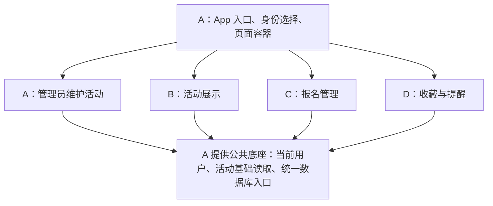

# 北航活动通：项目设计说明（易读版）

日期：2026-11-05。适用成员：A、B、C、D。

这份文档用于理解项目、分配任务和约定接入方式。先读中文功能说明即可；方法名用于以后与代码对照。工程状态更新于 2026-11-06。A 的七模块底座和管理用例已实现，实际调用以 [统一约定](协作开发统一约定.md) 和 [接口文档](interface-design.md) 为准。本文保留四人分工的易读说明。

## 1. 先记住整个项目怎样分工

> **A 提供公共底座和管理员功能；B 展示活动；C 管理报名；D 管理收藏和提醒。所有功能使用同一份数据库。**

| 成员 | 用户能使用的功能 | 主要需要实现的内容 |
| --- | --- | --- |
| A | 身份选择、页面跳转；管理员新增、编辑、取消活动 | 创建工程、统一用户和活动数据、数据库入口、页面容器、管理端、最终整合 |
| B | 活动列表、日历或时间轴、活动介绍 | 活动查询与展示、时间地点和报名状态展示、页面刷新 |
| C | 报名、取消报名、报名人数、我的报名 | 报名条件检查、防重复、名额限制、报名记录与人数计算 |
| D | 收藏、取消收藏、我的收藏、提醒设置、系统通知 | 收藏记录、提醒记录、定时调度、通知与恢复 |

技术沿用已有方案：Java 写行为，XML 描述界面，SQLite 保存数据；最终交付一个 APK。管理员和学生在同一个 App 内切换演示身份，读取同一部手机上的数据。



这张图表示功能归属。具体一次操作怎样调用其他人的能力，见第 5 节。

## 2. 同一个详情页，三个人怎样分别开发

```text
活动详情页：A 准备容器，传入当前活动的编号
┌──────────────────────────────────┐
│ 标题、时间、地点、介绍、来源说明     │ ← B
├──────────────────────────────────┤
│ 已报名人数、剩余名额、我的报名状态   │ ← C
│ [报名]  [取消报名]                 │
├──────────────────────────────────┤
│ [收藏]  [取消收藏]  [设置提醒]      │ ← D
│ 当前提醒时间、权限或设置失败提示     │
└──────────────────────────────────┘
```

- A 创建三个固定区域，并把同一个活动编号交给各区域。
- B、C、D 分别提供自己的界面组件，维护自己的布局和点击逻辑。
- A 将这些组件放进容器，并负责返回、跳转和身份切换。
- B 的列表也要显示报名状态，因此需要查询 C 的数据；详情中的报名按钮由 C 自己实现。

每个人修改自己的界面文件，通过接口取得别人的数据。

## 3. 接口到底指什么

**接口就是一份调用约定：能做什么、需要传什么、会返回什么。**

以 C 的“查询报名概况”为例：

| 项目 | 约定 |
| --- | --- |
| 谁实现 | C |
| 谁使用 | B 的活动列表、C 自己的报名面板 |
| 输入 | 活动编号，例如 42；当前用户由公共底座取得 |
| 输出 | 有效报名人数、剩余名额、我是否报名、是否允许报名及原因 |
| B 怎样使用 | 取得这些结果，把它们显示在列表中 |
| C 怎样实现 | 读取活动和报名记录，按统一规则计算结果 |

代码中的一个调用入口是 `RegistrationApi.getSummary(eventId)`。可以把它读成“查询当前用户对这场活动的报名概况”。

本文表格描述的是功能约定，省略了回调、线程和事务参数。实际 Java 声明和调用示例在底座完成后写入接口文档；普通界面操作通过异步方式返回结果。

## 4. 每个人实现什么，以及需要提供什么接口

### 4.1 A：公共底座、管理端和整合

**需要实现：**

1. 创建可构建、可安装的工程，写清启动方法。
2. 预置管理员、学生甲、学生乙，提供当前身份的读取和切换。
3. 定义统一的用户和活动对象，建立数据库入口及首次演示数据。
4. 准备活动列表入口、详情容器、我的报名和我的收藏等跳转位置。
5. 实现管理员新增、编辑、取消活动，并检查管理员权限和表单输入。
6. 把 B、C、D 的真实实现接入，验证完整流程，打包最终 APK。

**A 要预留并提供的接口：**

| 功能接口 | 给谁使用 | 输入 | 输出或效果 |
| --- | --- | --- | --- |
| 读取当前用户 | B、C、D | 无 | 用户编号、名字、角色 |
| 切换演示身份 | A 的身份选择页 | 目标用户编号 | 新的当前身份，相关页面刷新 |
| 查询活动列表 | B、A 的管理列表 | 筛选条件，可省略 | 活动基础资料列表 |
| 查询单场活动 | B、C、D | 活动编号 | 时间、地点、名额、状态、来源等最新活动资料 |
| 统一查询/写入数据 | 各成员的业务和数据代码 | 本次要执行的数据任务 | 查询结果，或保存成功/失败 |
| 页面跳转 | B、C、D | 目标页面、必要的活动编号 | 进入对应页面 |
| 页面组件接入位置 | B、C、D | 各自创建的页面或面板 | 放入主导航或详情容器 |
| 数据变化通知 | B、C、D | 哪场活动、哪类数据发生变化 | 提醒相关页面重新查询 |

代码对照：当前用户与切换使用 `SessionApi`，活动读取使用 `EventReadApi`，管理操作使用 `EventAdminApi`，数据任务使用 `DataAccess`，跳转使用 `Navigator`。

**A 需要向别人取得的能力：**

- 向 B 取得活动列表和内容面板，放进应用入口与详情页。
- 向 C 查询有效报名人数，校验管理员修改的名额是否足够。
- 取消活动时，请 C 取消该活动的有效报名，请 D 关闭其待提醒。
- 修改活动时间时，请 D 更新相关待提醒。

### 4.2 B：活动展示

**需要实现：**

1. 用日历或时间轴组织活动列表，显示时间、地点和状态。
2. 实现详情中的活动内容区域，显示介绍和来源。
3. 显示当前用户的报名状态；需要显示收藏状态时查询 D。
4. 在进入、返回、主动刷新和数据变化后重新读取数据。
5. 整理演示活动和来源说明，交给 A 的初始化或活动录入流程保存。

**B 要预留并提供的接口：**

| 功能接口 | 给谁使用 | 输入 | 输出或效果 |
| --- | --- | --- | --- |
| 创建活动列表页面 | A | 可选的初始筛选条件 | 可放入 App 的列表页面 |
| 创建活动内容面板 | A | 活动编号 | 可放入详情容器的内容面板 |
| 查询整理后的展示数据 | B 自己的页面 | 筛选条件或活动编号 | 活动资料，加上从 C、D 取得的相关状态 |

代码对照：B 的展示查询使用 `EventBrowseApi`；页面创建按 A 预留的页面接入约定实现。

**B 需要向别人取得的能力：**

- **B 使用 A 的活动查询接口取得标题、时间、地点、状态和来源。**
- **B 使用 C 的查询接口取得报名人数、剩余名额和当前用户报名状态。**
- **B 使用 D 的查询接口取得收藏状态，以及需要显示的提醒状态。**
- B 点击某场活动时，使用 A 的跳转接口进入详情。

B 负责把结果展示出来；报名条件和人数规则由 C 统一计算，收藏和提醒状态由 D 提供。

### 4.3 C：报名管理

**需要实现：**

1. 报名、取消报名、我的报名页面，以及详情中的报名面板。
2. 检查活动是否取消、截止或开始，是否满额，用户是否已报名。
3. 保存报名记录，防止重复记录，取消后正确恢复名额。
4. 统一计算有效人数、剩余名额和报名资格。
5. 提供管理员取消活动时需要的报名处理能力。

**C 要预留并提供的接口：**

| 功能接口 | 给谁使用 | 输入 | 输出或效果 |
| --- | --- | --- | --- |
| 查询报名概况，支持列表批量查询 | B、C 自己 | 活动编号；批量时提供活动列表 | 人数、余量、我的状态、能否报名及原因 |
| 报名 | C 的报名面板 | 活动编号 | 成功后的最新概况，或已报名/满额/截止等原因 |
| 取消自己的报名 | C 的报名面板、我的报名 | 活动编号 | 当前用户取消报名，人数和余量更新 |
| 查询我的报名 | C 的我的报名页面 | 无 | 当前用户的报名记录及对应活动 |
| 查询有效报名人数 | A | 活动编号 | 有效报名人数，用于修改名额时检查 |
| 取消某活动全部有效报名 | A 的取消活动流程 | 活动编号 | 保留记录，改为因活动取消而失效 |
| 创建报名面板、我的报名页面 | A | 面板需要活动编号 | 可由 A 放入容器或导航的界面 |

代码对照：日常操作使用 `RegistrationApi`；供 B 批量取状态的入口是 `RegistrationReadPort`；供 A 在统一事务中使用的入口是 `RegistrationEventPort`。

**C 需要向别人取得的能力：**

- 使用 A 的当前用户入口，确定“谁在报名”。
- 使用 A 的活动读取接口，取得执行时最新的活动状态、时间和名额。
- 使用 A 的数据入口保存自己的报名记录。
- 保存成功后，通过 A 的数据变化通知，让 B 和相关页面重新查询。

### 4.4 D：收藏与提醒

**需要实现：**

1. 收藏、取消收藏、我的收藏，以及详情中的收藏提醒面板。
2. 设置、修改、关闭提醒，保存提醒记录。
3. 调用系统定时和通知能力，点击通知进入正确活动。
4. 处理权限拒绝、调度失败、身份切换和重启恢复。
5. 活动取消后关闭待提醒；活动时间修改后更新待提醒。

**D 要预留并提供的接口：**

| 功能接口 | 给谁使用 | 输入 | 输出或效果 |
| --- | --- | --- | --- |
| 查询收藏和提醒状态，支持列表批量查询 | B、D 自己 | 活动编号或活动列表 | 是否收藏、提醒时间及是否生效 |
| 设置收藏目标状态 | D 的面板和我的收藏 | 活动编号、收藏或不收藏 | 最终收藏状态；重复操作不重复记录 |
| 查询我的收藏 | D 的我的收藏页面 | 无 | 当前用户收藏的活动 |
| 设置或关闭提醒 | D 的面板 | 活动编号；设置时还需提前几分钟 | 实际设置结果，失败时说明原因 |
| 关闭某活动的待提醒 | A 的取消活动流程 | 活动编号 | 关闭待提醒记录，提交后取消系统调度 |
| 活动时间变更处理 | A 的编辑活动流程 | 新旧活动资料 | 重算待提醒时间，已错过的标为过期 |
| 同步系统提醒 | A 的底座安排执行 | 读取最新身份、活动与提醒记录 | 取消失效调度，恢复有效调度，记录结果 |
| 创建收藏提醒面板、我的收藏页面 | A | 面板需要活动编号 | 可由 A 放入容器或导航的界面 |

代码对照：日常操作使用 `FavoriteApi`、`ReminderApi`；批量状态使用 `EngagementReadPort`；活动变更使用 `ReminderEventPort`；系统同步由 D 实现 `EffectHandler` 处理器。

**D 需要向别人取得的能力：**

- 使用 A 的当前用户和活动读取入口。
- 使用 A 的数据入口保存自己的收藏和提醒记录。
- 使用 A 提供的通知跳转约定，创建进入活动详情的通知入口。
- 保存后通知相关页面刷新；系统提醒同步任务由 A 的底座统一登记和安排。

收藏、报名、提醒相互独立。学生可以收藏但不报名，也可以未报名就设置提醒，因此 D 的基础功能无需等待 C 的报名实现。

## 5. 用五条流程理解接口怎样流动

### 流程一：学生浏览活动

```text
B 向 A 查询活动列表
    ↓
B 向 C 查询这些活动的报名概况
    ↓
B 按需要向 D 查询收藏与提醒状态
    ↓
B 把查询结果显示成列表
    ↓
点击活动 → 使用 A 的跳转入口 → A 装入 B、C、D 的详情面板
```

这里的“B 向 C 查询”表示调用约定好的接口；B 无需引用 C 的具体实现类。实际装配由 A 完成。

### 流程二：学生报名

```text
学生点击 C 面板的“报名”
    ↓
C 取得 A 提供的当前身份和最新活动
    ↓
C 检查状态、时间、重复报名和余量
    ↓
C 使用统一数据入口保存报名记录
    ↓
保存成功 → 通知数据变化 → C 更新面板，B 重新查询状态
```

名额检查与保存作为一次完整数据库事务执行，任何一步失败都不增加报名人数。

### 流程三：管理员取消活动

```text
管理员在 A 的页面确认取消
    ↓
A 开始一次统一数据库事务
    ├─ A：活动改为已取消
    ├─ 调用 C 的接口：取消该活动的有效报名
    └─ 调用 D 的接口：关闭该活动的待提醒
    ↓
三部分一起保存；任一失败则一起撤销
    ↓
提交后，D 取消系统提醒，相关页面刷新
```

此处 A 传入同一个事务环境，C、D 在其中同步完成数据库处理，各自不单独提交。系统调度在数据库提交之后执行。收藏记录保留，B、C、D 都展示活动的最新取消状态。

### 流程四：管理员修改时间或名额

- **修改活动时间：**A 校验并保存新时间，同时调用 D 的时间变更接口；D 更新待提醒记录，提交后重设系统调度。B 刷新时间显示。
- **修改名额：**A 通过 C 的接口查询有效人数，新名额不得小于该人数。人数检查和活动保存使用同一事务，B、C 随后刷新。

### 流程五：切换身份或重新启动

1. A 保存或恢复当前身份，通知个人相关页面重新加载。
2. B、C、D 的个人状态按当前用户重新查询，旧用户的延迟结果不显示到新用户页面。
3. A 的底座登记提醒同步任务，D 按最新身份取消旧用户调度、恢复当前用户有效提醒。
4. 数据库中的收藏、报名和提醒设置保留；模拟数据不重复插入。

## 6. 数据由谁维护，以及共同遵守什么

| 数据 | 谁实现日常读写 | 其他成员如何取得 |
| --- | --- | --- |
| 用户和当前身份 | A | 调用 A 的会话入口 |
| 活动基础资料 | A | 调用 A 的活动查询接口 |
| 报名记录和人数 | C | 调用 C 的查询或活动变更接口 |
| 收藏记录 | D | 调用 D 的查询和收藏接口 |
| 提醒记录与调度 | D | 调用 D 的查询、设置和活动变更接口 |

共同约定：

1. **同一场活动使用同一个活动编号。**B 展示、C 报名、D 提醒都关联这一个编号。
2. **当前用户从 A 的统一入口取得。**个人操作自动属于当前用户。
3. **各人实现自己功能的数据访问。**A 提供数据库工具并协调表结构，各成员通过接口访问别人的数据。
4. **人数只有一个计算口径。**C 统计有效报名记录，其他人使用 C 的结果。
5. **操作结果统一说明成功与失败。**返回是否成功、结果码、提示文字和需要的数据；失败不把界面改成成功状态。
6. **页面刷新时读取数据库。**进入、返回、主动刷新、本人操作完成和收到变化通知时，重新查询相关数据。
7. **提醒设置成功以实际调度结果为准。**保存意图与系统调度分开记录；失败如实提示并允许重试。

例如查询报名概况可以得到：“已报名 10 人，剩余 10 人，我未报名，可以报名。”报名失败可以得到：“名额已满，本次没有新增记录。”

## 7. 底座完成后，怎样让 BCD 并行开发

### 第一步：A 先交付最小可运行工程

- 能安装、启动和选择演示身份。
- 能从数据库读取至少一条活动，并进入详情。
- 当前用户、活动查询、数据保存、页面跳转等公共入口存在。
- B、C、D 的页面位置和接口声明已经准备好。
- 未实现的功能明确显示“待接入”，操作返回未接入；不返回虚假的成功或人数。
- README 写明运行步骤，接口说明写明在哪里调用、传什么、返回什么。

### 第二步：四人分别实现

| 成员 | 优先实现 | 随后完善 |
| --- | --- | --- |
| A | 新增活动、编辑表单、管理端页面 | 与 C、D 接通名额检查、活动取消和时间变更 |
| B | 活动列表和内容面板 | 接入 C、D 的真实状态，完善筛选与刷新 |
| C | 报名状态查询、人数统计、活动取消处理接口 | 报名/取消操作、面板、我的报名 |
| D | 早期验证系统提醒，提供收藏查询和活动变更接口 | 完整收藏提醒面板、调度和恢复 |

C 或 D 尚未完成时，B 可以使用明确的“待接入”状态继续做基本展示。A 的取消等操作若缺少必要的 C、D 处理，整笔操作提示未接入，不能跳过后显示成功。各人可用测试替身验证自己的模块，正式版本接入真实实现。

### 第三步：一起验收完整流程

1. A 新增活动 → B 刷新可见，来源、时间、地点一致。
2. C 报名成功 → B 和 C 显示一致的报名状态和人数。
3. 重复报名不增加人数，满额拦截，取消后名额恢复。
4. D 收藏和设置提醒 → 重新进入后状态保留，到时有真实通知。
5. A 取消活动 → 报名失效、待提醒关闭、收藏保留且显示已取消。
6. A 修改时间 → B 显示新时间，D 按规则更新待提醒。
7. 切换两个学生、重新启动 App → 个人数据隔离且不会丢失或重复。

## 8. 基础功能稳定后的选做

- **B：兴趣推荐。**保存用户偏好，结合活动和 C 的可报名状态提供推荐，显示真实理由。
- **C：签到反馈。**在自己模块中增加签到规则、记录与反馈页面。
- **活动摘要：**有余量时由 A 主责、B 协助，单独估时和约定新增接口。

底座和基础功能的协作先围绕本文件第 4、5、7 节执行。七模块目录、线程、生命周期与提醒恢复的技术实现，可在需要编码时对照 `architecture-design.md`。
